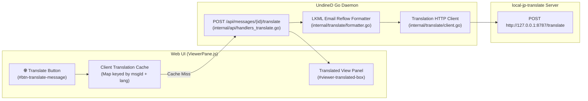

# Design Document: Local Email Reflow & Translation (`local-jp-translate`)

This document describes the architecture, email text reflow algorithm, chunking strategy, error handling, and configuration of UndineD's local message translation subsystem.

---

## 1. Overview & Motivation

Linux kernel mailing list (LKML) discussions and patch descriptions are written in plain-text English and follow strict RFC 5322 / kernel email formatting conventions:
- Lines are hard-wrapped around **72–80 columns**.
- Replies interleave multi-level quoted context prefixed with `>`, `>>`, `>>>`, etc.
- Emails mix natural-language paragraphs with indented code snippets, stack traces, ASCII diagrams, commit trailers (`Signed-off-by:`, `Fixes:`, `Reviewed-by:`), signatures (`-- `), and unified Git diffs (`---`, `diff --git`).

Feeding raw hard-wrapped LKML emails directly into a machine translation model produces poor translations because:
1. **Hard line breaks split grammatical clauses mid-sentence**, causing line-oriented or prompt-sensitive translation models to translate fragments out of context.
2. **Leading `>` quote markers inside wrapped paragraphs** confuse tokenization if not stripped before translation and restored afterward.
3. **Code blocks, commit trailers, and unified diffs** should remain verbatim rather than being translated or mangled.

Furthermore, kernel maintainers and developers often review sensitive or pre-release patches that should not be transmitted to external cloud translation services. UndineD therefore integrates with [**`local-jp-translate`**](https://github.com/marvelousu/local-jp-translate), a local loopback HTTP server backed by `llama.cpp` and `plamo-2-translate` / `plamo-3-translate` GGUF models.

---

## 2. System Architecture



### Why UndineD Proxies Requests Server-Side
According to the [`local-jp-translate` REST API specification](https://github.com/marvelousu/local-jp-translate/blob/main/docs/API.md):
- `local-jp-translate` binds to `127.0.0.1:8787` and **rejects browser requests carrying an `Origin` header with `403 origin_denied`** unless started with `--cors-origin` matching the exact web origin.
- When UndineD's Go backend calls `http://127.0.0.1:8787/translate` server-to-server, no browser `Origin` header is sent, eliminating CORS issues entirely.
- Server-side proxying also allows the UndineD Web UI to use local translation transparently when accessed over SSH port forwarding or a remote workstation tunnel.

---

## 3. LKML Email Reflow & Quote-Preserving Algorithm

Implemented in [`internal/translate/formatter.go`](../internal/translate/formatter.go), `ParseEmailSegments(raw string)` transforms a raw plain-text email into an ordered slice of structural `Segment` objects (`SegmentBlank`, `SegmentProse`, `SegmentVerbatim`).

### Step 1: Pre-Cleaning
- Normalizes `\r\n` and `\r` line endings to `\n`.
- Strips invisible email preheader padding characters (`\u2007`, `\u200b`, `\u034f`, `\ufeff`).

### Step 2: Quote-Depth Extraction
Each line is inspected for leading `>` quote markers (`parseQuotePrefix`):
- Counts the quote nesting depth (`0`, `1`, `2`, ...) and produces a normalized prefix (`""`, `"> "`, `">> "`, `">>> "`).
- Preserves any additional spaces after the single space following `>` so indented code blocks inside quotes are still detected accurately.

### Step 3: Verbatim Boundary & Line Classification
Lines are classified into three categories:
1. **Unquoted Patch Diff & Signature Tail (`inDiffOrSig`)**:
   - An unquoted signature delimiter (`-- ` or `--`), a `diff --git ` header, or a `---` line followed by a diffstat / unified diff switches the parser into tail-verbatim mode so the entire patch diff or signature block is kept untouched.
2. **Inline Verbatim Blocks (`SegmentVerbatim`)**:
   - Fenced code blocks delimited by ```` ``` ```` or `~~~`.
   - Indented code, command output, or stack traces (lines starting with `\t` or 2+ spaces after the quote prefix, unless continuing a bullet list item).
   - Standard kernel commit trailers (`Signed-off-by:`, `Reviewed-by:`, `Acked-by:`, `Tested-by:`, `Reported-by:`, `Suggested-by:`, `Co-developed-by:`, `Fixes:`, `Link:`, `Closes:`, `Cc:`).
   - Unified diff headers (`diff --git`, `index ...`, `--- a/...`, `+++ b/...`, `@@ ...`) and ASCII tables (`| ... |`, `+---`).
3. **Prose & Quoted Prose (`SegmentProse`)**:
   - **Attribution Headers** (`On Mon, ... wrote:`): Unwrapped if split across two lines, then flushed immediately as a standalone prose segment so it is never merged into the paragraph that follows.
   - **Bullet & Numbered List Items** (`- `, `* `, `+ `, `1. `, `1) `): Starts a new prose segment; indented continuation lines at the same quote depth unwrap into that list item while preserving its bullet marker.
   - **Standard Prose Paragraphs**: Consecutive prose lines at the same `QuoteDepth` are joined with a single space (`" "`), converting 80-column hard-wrapped lines into natural English sentences.

### Step 4: Chunked Translation & Quote-Prefix Restoration
Implemented in [`internal/translate/client.go`](../internal/translate/client.go):
- **Subject Translation**: Leading `[PATCH ...]` and `Re:` prefixes are separated so only the descriptive subject phrase is translated, then re-combined (e.g., `[PATCH v2 1/2] <translated subject>`).
- **Preventing `502 backend_truncated`**: `local-jp-translate` enforces a maximum `max_tokens` of `2048` and returns `502 backend_truncated` if a single response reaches `max_tokens`. Each unwrapped `SegmentProse` is translated individually (and any single paragraph exceeding 1,200 runes is split at sentence boundaries `. `, `? `, `! `).
- **Style Parameter Guard**: The `style` parameter (`"default"`, `"polite"`, `"plain"`) is only included in the `POST /translate` JSON payload when `target == "ja"`, adhering to the `local-jp-translate` API rule that rejects `style` with `400 style_target_mismatch` for non-Japanese targets.
- **Quote Prefix Re-application**: Once a quoted prose segment is translated, `ApplyPrefixToLines(translatedText, seg.QuotePrefix)` re-prefixes every line of the translated block with `> `, `>> `, etc.
- **FIFO Translation Queue & Message Switching**:
  - `translate.Client` serializes `TranslateEmail` jobs through an internal FIFO waiter queue (`acquireQueueTurn`) so that multi-paragraph emails never interleave `/translate` requests against `local-jp-translate`.
  - On the frontend (`api.js` and `ViewerPane.js`), translation requests are queued in FIFO order with single-flight deduplication (`getInFlightTranslation`). If the user selects another message while a translation is running, the job continues in the background, preserves its `⏳ Translating...` state if the user switches back before completion, and automatically caches and displays the translated view once completed.

---

## 4. Error Handling & Offline Server Detection

When the user clicks **🌐 Translate** in the message viewer:
1. **Server Not Running (`ECONNREFUSED` / Dial Error)** or **Model Still Loading (`503 not_ready`)**:
   - `internal/translate/client.go` wraps the error with `translate.ErrServerUnreachable`.
   - `POST /api/messages/{id}/translate` returns HTTP **`503 Service Unavailable`** with JSON:
     ```json
     {
       "error": "Local translation server is not running at http://127.0.0.1:8787 (...). Please start local-jp-translate and try again.",
       "code": "translate_server_unreachable"
     }
     ```
2. **Frontend Behavior on Error**:
   - `translateMessage()` in `frontend/src/api.js` throws an `Error` with the server's message and **never caches failed responses**.
   - `ViewerPane.js` restores the **🌐 Translate** button from `⏳ Translating...` back to its enabled state, keeps the original message view intact, and displays an error toast notification.
   - Once the user starts `local-jp-translate`, clicking **🌐 Translate** immediately retries and succeeds.

---

## 5. Configuration (`[translate]` in `config.toml`)

```toml
[translate]
enabled = true
url = "http://127.0.0.1:8787"
source_lang = "en"
target_lang = "ja"
# Style when target_lang = "ja": "default", "polite", or "plain"
style = "default"
max_tokens = 2048
timeout_seconds = 180.0
```
