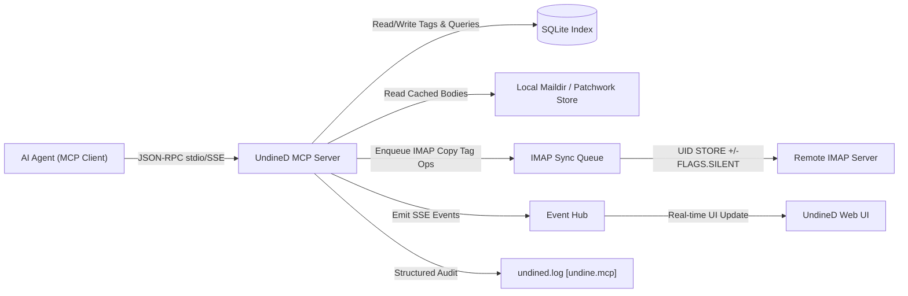
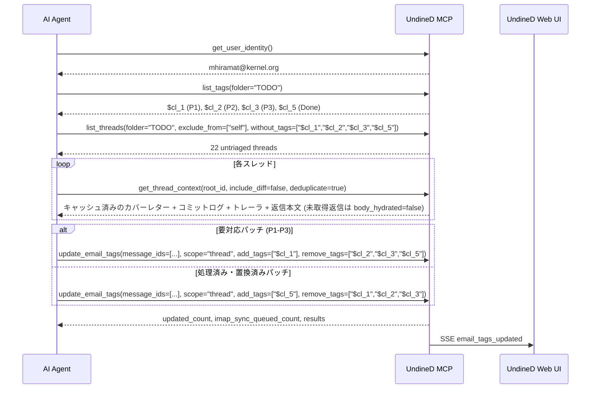

# UndineD MCP 拡張設計書: トリアージ・タグ管理・軽量コンテキスト API

## 1. 背景と目的

カーネルメンテナの `TODO` フォルダ（Patchwork で割り当てられたパッチを反映）に対する AI エージェント主導のトリアージ運用（例: 「自分の出したパッチ以外を記述から軽く確認し、重要度に応じて `$cl_1`–`$cl_3` タグを付与、処理済み・置換済みには `$cl_5` を付与する」）を検証した結果、現在の UndineD MCP サーバには以下のギャップがあることが判明した。

1. **タグ読み書き機能の欠如（ブロッカー）**: 既存メール・スレッドの UndineD / IMAP キーワード（`$cl_1`–`$cl_3`, `$cl_5` 等）を取得・更新するツールがない（新規ドラフト用の `create_mail_draft.tags` のみ）。
2. **シリーズ単位クエリ・フィルタの不足**: `list_recent_emails` は単体メール単位の返却で、ページネーション・`exclude_from`・未タグ絞り込み・スレッド集約がない。
3. **トリアージ時のトークン過剰消費**: `get_thread_context` が全パッチの生 diff を無条件で返すため、13 パッチのシリーズ等で 200KB 超のペイロードになる。
4. **未ハイドレート返信の明示不足と重複行**: `TODO` フォルダ自体は Patchwork 経由取得のためローカルキャッシュ済みだが、スレッド内の別 IMAP フォルダ（例: `kernel.org/mhiramat`）にある返信が `body_plain: ""` のまま返る場合があり、未取得状態か空本文か区別できない。また、同一 `Message-ID` の重複行が複数返却される。
5. **送信者自己判定の不可**: ユーザー自身のメールアドレス一覧を返すツールがなく、「自分の出したパッチ以外」をプロンプト推測に依存せざるを得ない。

本設計書は、既存の UndineD MCP 設計方針と安全性不変条件を維持しつつ、**Phase 1〜2** でこれらを解消するためのツール仕様・スキーマ・同期設計・テスト方針を定義する。

---

## 2. 設計原則・安全性不変条件・スコープ

> [!IMPORTANT]
> 既存のコア安全不変条件に加え、トリアージ操作に伴う明確なスコープと制約を設ける。

- **Zero SMTP Transmission（既存維持）**: MCP ツールは一切 SMTP 送信を行わない。
- **Zero Deletion / Zero Move（スコープ明確化）**: MCP ツールはメールの削除・完全消去（Expunge）およびフォルダ移動を行わない。`TODO` フォルダは Patchwork 割り当てを反映しているため移動は不要とし、**処理済み（pick 済み・v2 置換済み等）は `$cl_5` タグ付与**で表現する。
- **ローカルキャッシュ専用（オンデマンド IMAP FETCH 禁止）**: `TODO` は Patchwork 経由で取得済みであり、IMAP フォルダは大量のメールを含むため、MCP 呼び出しからオンデマンド IMAP `FETCH` は行わない。未取得メールはそのまま `body_hydrated: false` として返す。
- **汎用タグ操作＋クライアント側排他制御（案 A）**: サーバ側は汎用的なタグ追加・削除・置換 API に徹し、`$cl_1`–`$cl_3` / `$cl_5` 間の排他制御は呼び出し側が `add_tags` + `remove_tags` で明示指定する。
- **同一 `Message-ID` 全コピーへのデフォルト反映**: `folder` ガードを省略した場合、対象 `Message-ID` を持つ全フォルダ上のコピーへタグ変更を反映する。
- **冪等性・後方互換性**: 同一タグ更新の再実行は冪等とし、既存ツールの拡張はすべてデフォルト値付きオプショナル引数で行う。

### 導入ロードマップ（Phase 1〜2 に限定）

| Phase | スコープ | 主な追加・変更点 |
|---|---|---|
| **Phase 1（必須）** | タグ管理・基本メタデータ | `update_email_tags`, `list_tags`, `get_user_identity` 追加。既存読み取り API に `tags` フィールドを追加。 |
| **Phase 2（高効果）** | トリアージ最適化・軽量取得 | `list_threads` 追加。`get_email` / `get_thread_context` に `include_diff`, `deduplicate`, `body_hydrated` 追加。`list_recent_emails` / `search_emails` のフィルタ拡張。 |

*※ フォルダ移動（`move_emails` 等）は Patchwork 連携の `TODO` 運用（完了は `$cl_5` で管理）に不要なため本設計のスコープ外とする。*

---

## 3. アーキテクチャ概要



---

## 4. 新規 MCP ツール仕様

### 4.1 `update_email_tags`（Phase 1・必須）

既存メール（またはスレッド全体）に対して UndineD / IMAP キーワードタグを追加・削除・置換する。サーバ側は特定タグ間の暗黙排他を行わず、呼び出し側の `add_tags` / `remove_tags` 指定をそのまま適用する。

#### 入力 JSON Schema
```json
{
  "name": "update_email_tags",
  "description": "Add, remove, or replace UndineD/IMAP keyword tags (e.g. '$cl_1', '$cl_2', '$cl_3', '$cl_5') on existing emails or threads without sending, moving, or deleting mail.",
  "parameters": {
    "type": "object",
    "required": ["message_ids"],
    "properties": {
      "message_ids": {
        "type": "array",
        "items": { "type": "string" },
        "minItems": 1,
        "maxItems": 100,
        "description": "Target Message-IDs (with or without '<...>') or numeric DB IDs."
      },
      "add_tags": {
        "type": "array",
        "items": { "type": "string" },
        "default": [],
        "description": "Tags to add (e.g. ['$cl_1']). Cannot be combined with replace_tags."
      },
      "remove_tags": {
        "type": "array",
        "items": { "type": "string" },
        "default": [],
        "description": "Tags to remove (e.g. ['$cl_2', '$cl_3', '$cl_5']). Cannot be combined with replace_tags."
      },
      "replace_tags": {
        "anyOf": [
          { "type": "array", "items": { "type": "string" } },
          { "type": "null" }
        ],
        "default": null,
        "description": "If non-null, replaces the entire user-tag set on target emails. Mutually exclusive with add_tags/remove_tags."
      },
      "scope": {
        "type": "string",
        "enum": ["message", "thread"],
        "default": "message",
        "description": "'message' updates target Message-IDs; 'thread' expands to all messages in the same thread."
      },
      "folder": {
        "anyOf": [{ "type": "string" }, { "type": "null" }],
        "default": null,
        "description": "Optional folder guard (e.g. 'TODO'). Default null updates ALL folder copies sharing the target Message-ID(s)."
      },
      "dry_run": {
        "type": "boolean",
        "default": false,
        "description": "If true, validates targets and returns planned before/after tag diffs without mutating state."
      }
    }
  }
}
```

#### バリデーション規則
- `replace_tags` と `add_tags` / `remove_tags` の併用は拒否（`-32602`）。
- `add_tags`・`remove_tags` が両方空かつ `replace_tags` が `null` の場合は拒否。
- `add_tags` と `remove_tags` の両方に同一タグが含まれる場合は拒否。
- 各タグ文字列は RFC 3501 の `flag-keyword`（IMAP atom）に準拠すること:
  - 許可文字: `[A-Za-z0-9$_\-.]`（長さ 1〜64 文字）。
  - 禁止: 空白・制御文字（CR/LF 含む）・`\` で始まる IMAP システムフラグ（`\Deleted`, `\Seen`, `\Draft` 等）・ワイルドカード（`*`, `%`）。
- 1 メールあたりの最大タグ数上限（例: 32）を超過する場合は拒否。

#### 返却スキーマ
```json
{
  "success": true,
  "dry_run": false,
  "scope": "thread",
  "folder_filter": null,
  "updated_count": 6,
  "unchanged_count": 0,
  "imap_sync_queued_count": 3,
  "results": [
    {
      "id": 13094,
      "message_id": "20261115123733.1234-1-vladimir.kondratiev@mobileye.com",
      "folder_name": "TODO",
      "before_tags": [],
      "after_tags": ["$cl_1"],
      "changed": true,
      "imap_sync_queued": false
    },
    {
      "id": 12940,
      "message_id": "20261115123733.1234-1-vladimir.kondratiev@mobileye.com",
      "folder_name": "kernel.org/mhiramat",
      "before_tags": [],
      "after_tags": ["$cl_1"],
      "changed": true,
      "imap_sync_queued": true
    }
  ],
  "not_found": []
}
```

#### トリアージでの推奨利用パターン
- **優先度付与（例: P1 に設定し他の優先度・完了タグを外す）**:
  ```json
  {
    "message_ids": ["13094"],
    "scope": "thread",
    "add_tags": ["$cl_1"],
    "remove_tags": ["$cl_2", "$cl_3", "$cl_5"]
  }
  ```
- **処理済み・置換済みマーク（`$cl_5` を付与し P1–P3 タグを外す）**:
  ```json
  {
    "message_ids": ["12621"],
    "scope": "thread",
    "add_tags": ["$cl_5"],
    "remove_tags": ["$cl_1", "$cl_2", "$cl_3"]
  }
  ```

---

### 4.2 `list_tags`（Phase 1・推奨）

UndineD に定義されているカラーラベル（`$cl_1`–`$cl_5` 等）およびカスタムタグ一覧と、任意フォルダ内の付与件数を返す。

#### 入力 JSON Schema
```json
{
  "name": "list_tags",
  "description": "List configured UndineD color labels and known custom tags, optionally with message counts in a folder.",
  "parameters": {
    "type": "object",
    "properties": {
      "folder": {
        "anyOf": [{ "type": "string" }, { "type": "null" }],
        "default": null,
        "description": "Optional folder name to scope usage counts."
      }
    }
  }
}
```

#### 返却スキーマ
```json
{
  "color_labels": [
    { "tag": "$cl_1", "display_name": "P1 / Important", "color": "#e53935", "count": 7 },
    { "tag": "$cl_2", "display_name": "P2 / Normal", "color": "#fb8c00", "count": 13 },
    { "tag": "$cl_3", "display_name": "P3 / Low", "color": "#fdd835", "count": 3 },
    { "tag": "$cl_5", "display_name": "Done / Resolved", "color": "#43a047", "count": 25 }
  ],
  "custom_tags": [
    { "tag": "PR-Draft", "count": 1 }
  ]
}
```

---

### 4.3 `get_user_identity`（Phase 1・推奨）

「自分の出したパッチ以外」を確実に除外できるよう、UndineD 設定上の送信者アドレス・別名一覧を返す（認証トークンやパスワード等は一切含めない）。

#### 入力 JSON Schema
```json
{
  "name": "get_user_identity",
  "description": "Return the configured user's display name and email addresses/aliases for self-authorship filtering.",
  "parameters": {
    "type": "object",
    "properties": {}
  }
}
```

#### 返却スキーマ
```json
{
  "display_name": "Masami Hiramatsu (Google)",
  "primary_email": "mhiramat@kernel.org",
  "aliases": [
    "mhiramat@kernel.org",
    "mhiramat@google.com"
  ]
}
```

---

### 4.4 `list_threads`（Phase 2・高効果）

フォルダ内のメールを **スレッド／パッチシリーズ単位** に集約して一覧取得するトリアージ専用ツール。13 パッチのシリーズが 13 行に展開されて `limit` を消費する問題を解消する。

#### 入力 JSON Schema
```json
{
  "name": "list_threads",
  "description": "List email threads or patch series in a folder with series-level aggregation, tag filtering, and cursor pagination.",
  "parameters": {
    "type": "object",
    "properties": {
      "folder": {
        "anyOf": [{ "type": "string" }, { "type": "null" }],
        "default": null,
        "description": "Folder name to filter by (e.g. 'TODO')."
      },
      "limit": {
        "type": "integer",
        "default": 30,
        "minimum": 1,
        "maximum": 200
      },
      "cursor": {
        "anyOf": [{ "type": "string" }, { "type": "null" }],
        "default": null,
        "description": "Opaque pagination cursor returned by the previous call."
      },
      "exclude_from": {
        "type": "array",
        "items": { "type": "string" },
        "default": [],
        "description": "Email addresses to exclude by thread root author. Special value 'self' expands to configured user emails."
      },
      "patches_only": {
        "type": "boolean",
        "default": false,
        "description": "If true, include only threads containing at least one patch message in the target folder."
      },
      "has_tags": {
        "type": "array",
        "items": { "type": "string" },
        "default": [],
        "description": "Return only threads that have at least one of these tags."
      },
      "without_tags": {
        "type": "array",
        "items": { "type": "string" },
        "default": [],
        "description": "Exclude threads that already have any of these tags (e.g. ['$cl_1', '$cl_2', '$cl_3', '$cl_5'] for untriaged)."
      },
      "sort": {
        "type": "string",
        "enum": ["latest_date_desc", "latest_date_asc"],
        "default": "latest_date_desc"
      }
    }
  }
}
```

#### 返却スキーマ
```json
{
  "total_threads": 22,
  "returned": 22,
  "next_cursor": null,
  "threads": [
    {
      "thread_id": "thr_9f2a1c",
      "root_message_id": "cover.1794746252.git.vladimir.kondratiev@mobileye.com",
      "subject": "[PATCH v4 0/3] riscv: probes: reject probes inside an LR/SC sequence",
      "author_name": "Vladimir Kondratiev",
      "author_addr": "vladimir.kondratiev@mobileye.com",
      "latest_date": "2026-11-18 17:43:06 +0200",
      "patch_count_in_folder": 3,
      "total_messages_in_thread": 7,
      "reply_count": 3,
      "folder_message_ids": [13094, 13095, 13093],
      "tags": [],
      "tags_consistent": true,
      "has_my_reply": false,
      "has_unhydrated_replies": true
    }
  ]
}
```

---

## 5. 既存 MCP ツールの後方互換拡張

### 5.1 `list_recent_emails` の拡張（Phase 1 / 2）

- **追加パラメータ（すべて任意）**:
  - `offset: int = 0`
  - `exclude_from: list[str] = []`（`"self"` 対応）
  - `has_tags: list[str] = []`
  - `without_tags: list[str] = []`
  - `is_patch: bool | null = null`
- **レスポンス追加フィールド**（各要素）:
  - `tags: list[str]`（Phase 1）
  - `thread_id: str`（Phase 2）

### 5.2 `get_email` / `get_message` の拡張（Phase 1 / 2）

- **追加パラメータ（すべて任意）**:
  - `include_diff: bool = true`
    - `false` の場合、`body_plain` から `diff --git ...` 以降を除外し、コミットログ・トレーラ・diffstat のみを返す。
- **ローカルキャッシュ専用ポリシー**:
  - オンデマンド IMAP `FETCH` は行わない。ローカル未取得（`file_path == ""` かつ DB 未キャッシュ）の場合は空文字のまま `body_hydrated: false` を返す。
- **レスポンス追加フィールド**:
  - `tags: list[str]`（Phase 1）
  - `body_hydrated: bool`（Phase 2）
  - `trailers: dict[str, list[str]]`（`Fixes`, `Reviewed-by`, `Acked-by`, `Reported-by`, `Cc-stable` 等）
  - `diffstat: str`（`---` 〜 `diff --git` 間のファイル変更統計）

### 5.3 `get_thread_context` の拡張（Phase 1 / 2）

- **追加パラメータ（すべて任意）**:
  - `include_diff: bool = true` — `false` でトリアージ時のトークン使用量を約 80–90% 削減。
  - `deduplicate: bool = true` — 同一 `message_id` が複数フォルダ（例: `TODO` と `kernel.org/mhiramat`）に存在する場合、本文キャッシュ済みコピーを優先して 1 件に統合し、`folders: list[str]` と `folder_ids: list[int]` に全所属先を返す。
- **ローカルキャッシュ専用ポリシー**:
  - IMAP フォルダ側の未取得返信は取得せず、`body_hydrated: false` としてヘッダ情報（送信者・日時・件名）のみ返す。
- **レスポンス追加フィールド**（各メッセージ）:
  - `tags: list[str]`
  - `folders: list[str]`（`deduplicate=true` 時）
  - `body_hydrated: bool`

### 5.4 `search_emails` の拡張（Phase 2）

- **追加パラメータ**: `folder`, `has_tags`, `without_tags`。
- **レスポンス追加フィールド**: `folder_name`, `tags`。

---

## 6. データ永続化・同期・イベント・ログ設計

### 6.1 SQLite スキーマ（タグ検索高速化）

```sql
CREATE TABLE IF NOT EXISTS email_tags (
    email_id INTEGER NOT NULL REFERENCES emails(id) ON DELETE CASCADE,
    tag TEXT NOT NULL,
    updated_at INTEGER NOT NULL,
    PRIMARY KEY (email_id, tag)
);

CREATE INDEX IF NOT EXISTS idx_email_tags_tag ON email_tags(tag, email_id);
```

- `without_tags` 検索は `NOT EXISTS (SELECT 1 FROM email_tags t WHERE t.email_id = e.id AND t.tag IN (...))` で高速実行可能。

### 6.2 同一 `Message-ID` 全コピーへのデフォルト反映と IMAP 同期

`TODO` フォルダは Patchwork 経由でローカル生成される一方、同じパッチのコピーが IMAP フォルダ（例: `kernel.org/mhiramat`）にも存在しうるため、以下のセマンティクスを採用する。

1. **ターゲット解決（デフォルト: 全コピー反映）**:
   - 入力が `Message-ID` でも数値 DB ID（例: `TODO` 上の `14930`）でも、まず正規化 `message_id` を解決する。
   - `scope: "thread"` の場合は、全フォルダ横断でスレッド内の全 `message_id` を展開する（カバーレターが別フォルダにあるケースにも対応）。
   - `folder` が `null`（デフォルト）の場合、対象 `message_id` 群に一致する **全フォルダ上の全レコード** を更新対象とする。
   - `folder` が明示指定された場合のみ、そのフォルダに属するコピーに更新対象を限定する。
2. **トランザクション更新＋条件付き IMAP 同期**:
   - 全対象レコードの `email_tags` 更新を単一 SQLite トランザクション内で実行する。
   - 各コピーの所属フォルダ種別を確認し、**IMAP バックエンドフォルダ上のコピー（有効な IMAP UID を持つもの）のみ** `imap_sync_queue` へ `UID STORE <uid> +FLAGS.SILENT` / `-FLAGS.SILENT` を登録する（Patchwork 由来の `TODO` コピーはローカル完結）。
   - IMAP サーバがカスタムキーワード非対応またはオフラインの場合も、ローカル SQLite のタグ更新は成功させ、同期可否を `imap_sync_queued` とログで記録する。

### 6.3 SSE Event Hub 通知

Web UI が開かれている状態でエージェントがタグを付与した際、即座に色ラベルが再描画されるようイベントを発行する:

```json
{
  "event": "email_tags_updated",
  "data": {
    "updates": [
      {
        "id": 14930,
        "folder": "TODO",
        "message_id": "20261126132830.14992-1-atenart@kernel.org",
        "tags": ["$cl_1"]
      },
      {
        "id": 14584,
        "folder": "kernel.org/mhiramat",
        "message_id": "20261126132830.14992-1-atenart@kernel.org",
        "tags": ["$cl_1"]
      }
    ]
  }
}
```

### 6.4 MCP アクセスログ（`[undine.mcp]`）

既存の `undined.log` フォーマットに準拠する:

```log
2026-11-28 11:40:01 [INFO] [undine.mcp] MCP access: list_threads(folder='TODO', exclude_from=['self'], without_tags=['$cl_1','$cl_2','$cl_3','$cl_5']) -> 22 threads (8.2ms)
2026-11-28 11:40:15 [INFO] [undine.mcp] MCP access: update_email_tags(ids=1, scope='thread', folder=None, add=['$cl_1'], remove=['$cl_2','$cl_3','$cl_5']) -> SUCCESS (updated=6, imap_sync_queued=3) (4.5ms)
2026-11-28 11:40:16 [WARNING] [undine.mcp] MCP access: update_email_tags(ids=1, add=['\\Deleted']) -> REJECTED (Invalid tag syntax: system flag disallowed) (0.4ms)
```

---

## 7. エンドツーエンドのトリアージ実行フロー（導入後）



---

## 8. テスト・検証計画

1. **ユニットテスト**
   - タグバリデーション: `$cl_1`–`$cl_5`・カスタムタグ許可、`\Deleted`・空白・CR/LF・65文字超・`replace_tags` 併用・`add_tags`/`remove_tags` 重複を拒否。
   - Diff ストリップ（`include_diff=false`）: コミットログ・`Fixes:` / `Reviewed-by:` / `Cc: stable` トレーラ・diffstat が欠損せず、ユニファイド diff のみが除去されること。
   - 重複排除（`deduplicate=true`）: `TODO`（ローカルキャッシュ済み）と `kernel.org/mhiramat`（未キャッシュ）の同一 `Message-ID` で本文キャッシュ済みコピーが優先され、`folders` に両フォルダ名が含まれること。
2. **統合テスト**
   - デフォルト（`folder: null`）で `TODO` の数値 ID を指定して `update_email_tags(scope="thread")` を実行した際、同一 `Message-ID` を持つ `TODO` コピーと `kernel.org/mhiramat` コピーの両方にタグが付与され、IMAP コピーのみ `imap_sync_queue` に積まれること。
   - `folder: "TODO"` を明示した場合のみ、`TODO` 側コピーに更新が限定されること。
   - `dry_run=true` で DB・同期キュー・SSE が一切発火しないこと。
   - 未ハイドレートの IMAP 返信を含むスレッドで `get_thread_context` が IMAP ネットワーク通信を一切行わず `body_hydrated: false` を返すこと。
   - `list_threads(exclude_from=["self"], without_tags=["$cl_1","$cl_2","$cl_3","$cl_5"])` が P1–P3 または `$cl_5`（処理済み）付与後のスレッドを正しく除外すること（冪等な増分トリアージ検証）。

---

## 9. 確定済みの設計判断

| 項目 | 決定事項 | 理由 |
|---|---|---|
| 優先度タグの排他制御 | **案 A（クライアント側で `add_tags` + `remove_tags` 明示指定）** | サーバ側を汎用タグ操作に保ち、複数タグ併用や `$cl_5` 運用にも柔軟に対応できるため。 |
| 重複コピーのタグ反映範囲 | **デフォルトで同一 `Message-ID` の全コピーへ反映** | `TODO`（Patchwork 由来）と IMAP フォルダ間でタグ状態を一致させ、IMAP 側へも同期させるため。 |
| 未取得メールの本文取得 | **ローカルキャッシュのみ参照（オンデマンド IMAP FETCH なし）** | `TODO` は Patchwork 経由でキャッシュ済みであり、大量のメールがある IMAP フォルダへのオンデマンド取得は遅延が大きいため。 |
| 導入スコープと完了管理 | **Phase 1〜2 のみ実装（`move_emails` 不要、完了は `$cl_5` 付与）** | `TODO` は Patchwork の割り当てミラーであり移動は不要。処理済みアイテムは `$cl_5` タグで区別する運用とする。 |
